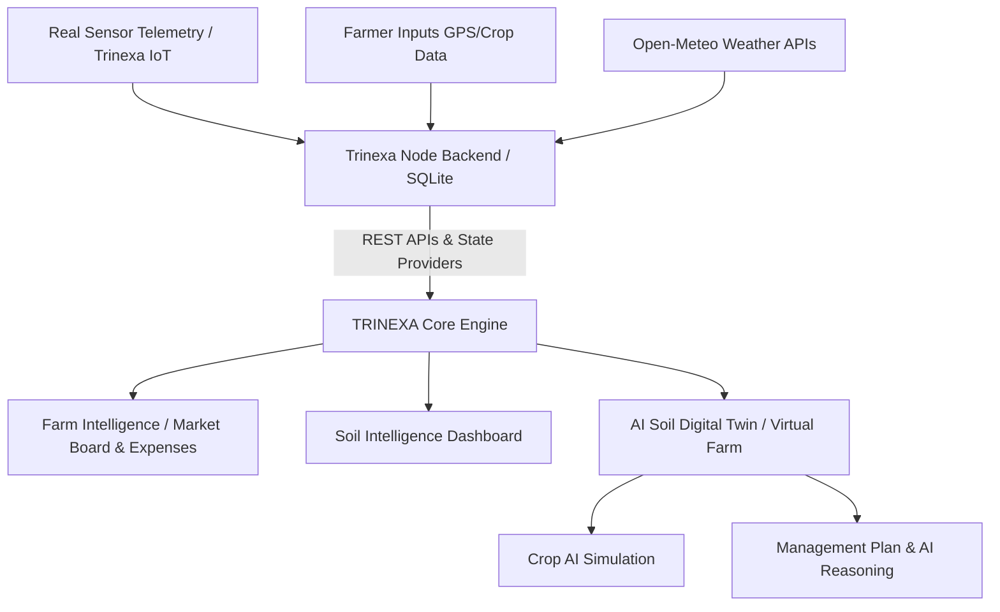

# TRINEXA: AI-Powered Soil Intelligence Platform
**Project Architecture & Workflow Report**

> [!NOTE]  
> This document provides a comprehensive top-down view of the TRINEXA software platform. It is designed so that any engineer, product manager, or evaluator can immediately understand how the software functions, how data moves through the architecture, and how the core AI subsystems operate.

---

## 1. Product Overview

**TRINEXA** is a localized, AI-powered agricultural management and soil intelligence system. The system shifts away from generic farm management and heavily prioritizes "Soil Health" via hardware-linked telemetry, actionable AI simulations, and persistent tracking.

### Core Philosophy
The platform operates on the principle of the **"Real Farm vs. Simulated Farm."**
Data is physically collected through the **Trinexa Core** (IoT sensors and nodes) and processed in the cloud to build the **Digital Twin.** Farmers use the platform to interrogate their land via simulations (Virtual Farm) without taking physical risks to their crops.

---

## 2. Technology Stack

TRINEXA utilizes a modern, decoupled monolithic stack:
- **Frontend (UI/UX):** React.js + TypeScript + Vite, using Tailwind CSS and Framer Motion for high-fidelity 2D/3D visualizations.
- **Backend (API & Database):** Node.js + Express.js, connecting to a lightweight local **SQLite3** database. 
- **Telemetry System:** Real-time data streaming (simulated via deterministic backend loops mapping to WebSocket/REST endpoints to prep for MQTT physical integration).
- **External Integration:** The platform proxies the *Open-Meteo API* via the backend to prevent CORS issues, dynamically fetching weather based precisely on the Farm's GPS coordinates.

---

## 3. System Architecture Hierarchy

The product is categorized into distinct architectural layers:

### 3.1 The Global Providers (State Management)
To ensure that a user changing a setting affects the *entire* app, TRINEXA uses React Context Providers:
- **`FarmProvider`:** Controls "Where are we?". When a farmer switches from *Farm A* to *Farm B*, `FarmProvider` instantly updates the global GPS coordinates. In response, the weather system updates to Farm B's location, the ledger switches to Farm B's expenses, and the telemetry dials into Farm B's soil hardware.
- **`TelemetryProvider`:** Acts as the circulatory system. It queries the backend API continuously, supplying the rest of the application with live NPK (Nitrogen, Phosphorus, Potassium), moisture, temperature, and pH values.

---

## 4. Core User Workflows

### A. The Onboarding Flow (`/onboarding`)
1. **User Action:** The farmer launches TRINEXA and accesses the Onboarding interface.
2. **System Action:** A new farm is registered via `POST /api/farms`. The user inputs the Farm Name, Area (acres), and simulates capturing their GPS Latitude & Longitude.
3. **Database Consequence:** The farm is saved to SQLite, isolating its data. This farm immediately becomes the global `activeFarm`.

### B. Live Telemetry Analysis (`/dashboard`)
1. **User Action:** The dashboard serves as the physical reality check.
2. **System Action:** Evaluates the `useTelemetry()` stream. It weights NPK and Moisture parameters to generate a 0-100 **Soil Health Score**.
3. **Feedback:** If moisture drops below optimal levels, warning logs appear in the activity timeline, allowing the farmer to react in real-world time.

### C. The Virtual Farm & Digital Twin (`/virtual-farm`)
This is the signature AI tool of TRINEXA. 
1. **Visualization Initialization:** TRINEXA generates a 2.5D graphical "Digital Twin" of the active farm. It slices the farm into geographic tracking zones and renders physical dirt extrusions using 3D CSS transforms. Topography color changes dynamically based on current water/nutrient stress.
2. **Target Setup:** The farmer selects a crop (e.g., Basmati Rice) from the CROP_DB logic core.
3. **Simulation Computation:** TRINEXA overlays the selected crop's fundamental biological requirements against the *actual* telemetry parameters mapping currently to the soil.
4. **"Why?" Output Matrix:** TRINEXA deduces suitability. For example, if the real-time Phosphorus is 30mg/kg but Tomato requires 40mg/kg, the engine flags a deficiency and recommends applying "DAP/SSP" fertilizer before seed sowing.
5. **What-If Engine:** The farmer uses UI sliders to simulate modifying moisture or nutrients without overriding the database bounds. The 3D plants visually grow/shrink, and the AI Health Score dynamically recalculates based on these hypothetical fixes.

---

## 5. Hardware Interoperability Strategy

Because the goal of the current module is software-first validation, all hardware triggers logically act like they have hit their mechanical limit. 

> [!IMPORTANT]  
> Interfaces explicitly control expectations:
> - **Irrigation Board:** The water UI shows live zone capacity. But instead of triggering a fake water-pump sequence, actionable buttons say **"EXT. RELAY PENDING."** 
> - **Automation System:** Logic gates exist in the software (If Moisture < 30% -> Turn on Valve C), but are marked internally as **"Awaiting Physical Integration."**

This ensures that anyone reviewing the source code immediately understands where the software boundary ends, and where the physical IoT wiring is expected to pick up in Phase II.

---

## 6. How the Backend Persists Data

TRINEXA does not rely on volatile browser cookies for critical mechanics.
The backend operates on port **3001** via `server/index.ts`. On initialization, it checks for a permanent `database.sqlite` file. If none exists, it seeds the tables:

- **`farms` Table:** Stores unique `id`, `name`, `area`, `lat`, and `lon`.
- **`expenses` Table:** An economic ledger bound to specific `farm_id` rows. Adding a Seed cost to Farm A explicitly restricts Farm B from seeing it via SQL `WHERE` clauses.
- **Simulation Loop:** The Node server runs an infinite `setInterval()` telemetry loop. Rather than randomly generating static numbers, it applies organic "drift" algorithms (slowly degrading moisture over time) and feeds this through REST endpoints. This grants evaluating bodies the realism of fluctuating data without physically wiring a soil probe for the demonstration.

---
## Conclusion

TRINEXA represents a deterministic, scalable architecture bridging the gap between farm telemetry and algorithmic prediction. The software handles persistence locally, isolates cross-tenant data elegantly, fetches real-world variables, and leverages the Digital Twin framework to transition agriculture from reactive troubleshooting to proactive intelligence.
